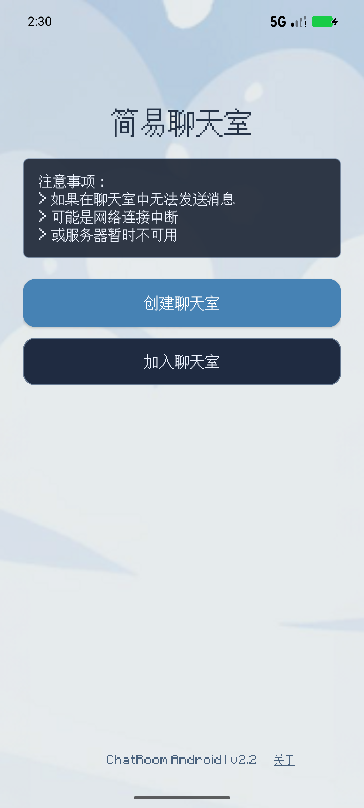
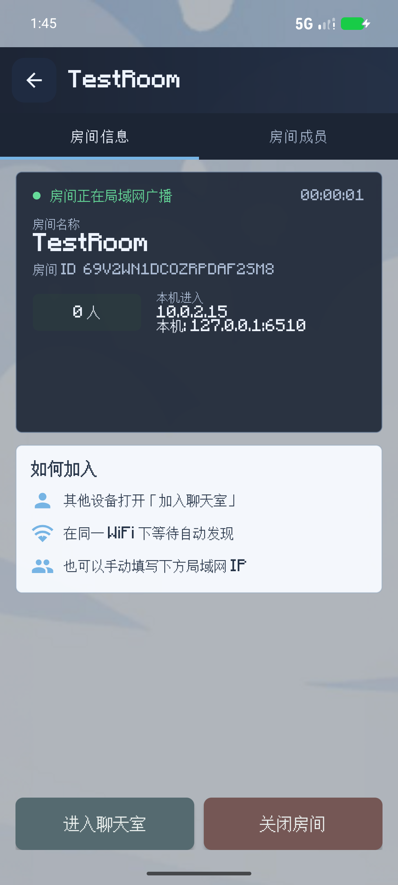

# ChatRoom Android Studio

Material Design 2.0 原生 Android 客户端，使用 Java + Material Components 实现。

## 界面预览

<p align="center">
  
  
  
</p>

## 功能

- 创建房间并作为主机运行 `6510/TCP` 与 `6511/UDP`
- UDP 自动发现局域网房间；UDP 被路由器/防火墙拦截时，自动用 TCP `6510` 探测本网段作为兜底
- 手动输入 IP / IP:端口加入
- 手动连接先检测服务，连通后再设置昵称
- Android 模拟器会自动把 `127.0.0.1` / `localhost` 映射到宿主机 `10.0.2.2`
- 房间信息卡片显示房间名称、完整 20 位房间 ID、在线人数和全部本机 IPv4 地址
- 昵称、在线人数、加入/离开通知
- 聊天消息、房间信息、连接超时检测
- 输入框禁止 Emoji；收到含 Emoji 的旧消息时会自动剥离
- 使用 `ChatRoom_v2.2` 内的 Minecraft 字体与内置插图
- 获取 Wi-Fi MulticastLock，提升 Android 对接 Windows 房间广播的兼容性

## 工程

用 Android Studio 打开：

```text
ChatRoom_of_Android/android-studio
```

包名：`com.nuoezin.chatroomnative`

最低系统版本：Android 6.0（API 23）

目标 SDK：36

## 构建

```bat
cd ChatRoom_of_Android\android-studio
gradlew.bat assembleRelease
```

输出：

```text
app/build/outputs/apk/release/app-release.apk
```

Release 构建可使用工程本地的 `.signing/chatroom-native.jks` 与 `keystore.properties`；
没有本地签名配置时，可先使用 `gradlew.bat assembleDebug` 构建调试 APK。

## 协议

- TCP `6510`：昵称、聊天、心跳、在线人数
- UDP `6511`：房间发现广播 `&sern=房间名|人数|端口|房间ID`
- 与 `ChatRoom_v2.2`、`RoomServer` 使用相同协议
- 房主未进入聊天时，房间显示人数为 0；进入后房主计为 1 人

## 连接 Windows 房间

Windows 端使用 GameMaker 的 UDP 广播，部分路由器会拦截局域网广播，Android 模拟器也无法接收宿主机的 UDP 广播。客户端检测不到广播时，会自动探测本网段（以及模拟器的 `10.0.2.2`）的 TCP `6510`，因此 Windows 房间仍会出现在列表中，名称显示为“局域网房间”。点击后输入昵称即可加入。

如果 TCP 探测也失败，请检查 Windows 防火墙是否允许 `ChatRoom.exe` 接收入站 TCP `6510`，并确认 Android 设备与 Windows 电脑处于同一局域网。
