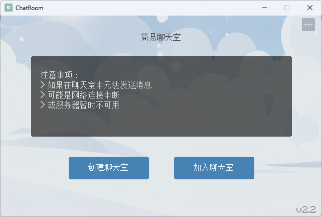
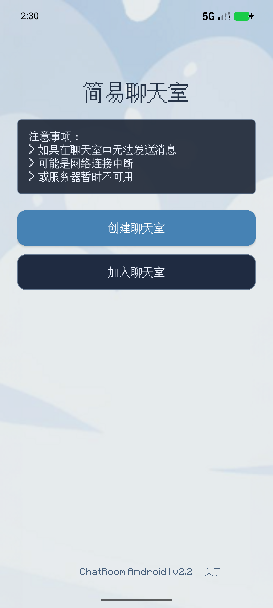
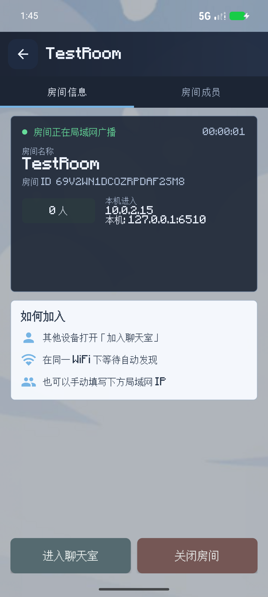
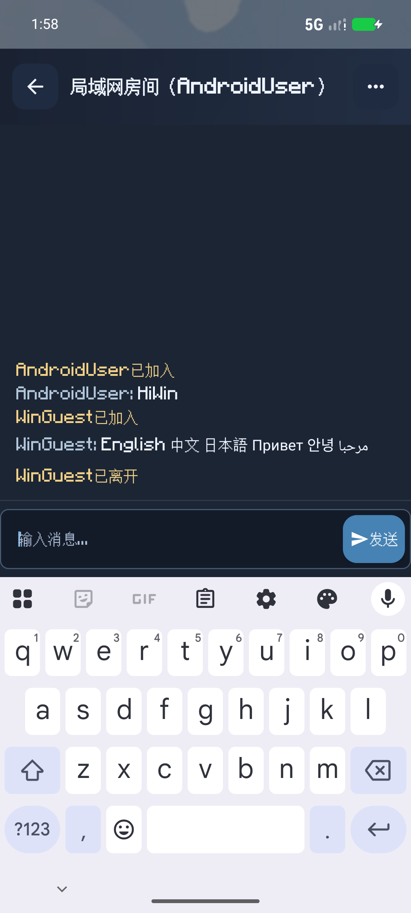

# ChatRoom

一个使用 GameMaker 打造的简易局域网聊天室项目

本项目主要是在原项目的基础上重新制作了一层 UI，核心通信部分有进行大幅修改，因此现在**可能与原来的旧版本不再互通**

<p align="center">
  
</p>

## Android 客户端

仓库内的 [`ChatRoom_of_Android/android-studio`](ChatRoom_of_Android/android-studio) 是使用 Java 重写的 Android 原生客户端，与 Windows / GameMaker 版本共用 `6510/TCP`、`6511/UDP` 协议，可以直接互相发现和聊天

<p align="center">
  
  
  
</p>

- 支持创建房间、UDP 自动发现、手动 IP 连接和房主直接进入聊天室
- 房间主页包含“房间信息 / 房间成员”两个选项卡
- 聊天界面使用与 Windows 版一致的纯文本左对齐样式
- 中文、日文、英文使用内置 Minecraft 字体，其他语言文字使用系统字体
- 输入框禁用了 Emoji
- UDP 广播被路由器或模拟器 NAT 拦截时，会自动通过 TCP `6510` 探测局域网房间

### 构建 Android 客户端

```bat
cd ChatRoom_of_Android\android-studio
gradlew.bat assembleRelease
```

输出位于 `ChatRoom_of_Android/android-studio/app/build/outputs/apk/release/app-release.apk`。仓库不包含签名文件和构建产物，签名配置请参考 [Android Studio README](ChatRoom_of_Android/android-studio/README.md)。

## Windows / GameMaker 客户端使用说明

如果创建了聊天室的主机端也想加入自己创建的聊天室，需要：

1. 保持当前作为本地服务端的窗口存在；
2. 另外再打开一个新的软件窗口；
3. 手动连接至以下 IP：

```text
127.0.0.1
```

> `127.0.0.1` 表示本机地址

其他设备加入聊天室时，请连接主机所在设备的局域网 IP，并根据程序要求填写对应端口

## 项目来源

本项目基于以下项目进行修改：

- 原项目：[WheatBox/GameMakerChatRoom](https://github.com/WheatBox/GameMakerChatRoom)


## 参考资料

### 原作视频

[Bilibili：原作视频](https://www.bilibili.com/video/BV1eL41157bP/?share_source=copy_web&vd_source=231ec7fa721b685ec648dd6fc6942529)

### 文本框代码源码

[Bilibili：文本框代码源码](https://www.bilibili.com/video/BV1qP4y1s7jt)

## 说明

这个版本并不是对原项目进行完全重写，主要工作是重新设计和套用 UI

感谢原作者以及相关教程作者提供的项目与代码参考

## 免责声明

**本项目仅供学习、交流和技术研究使用，请勿用于任何商业用途或非法用途。使用本项目所产生的任何直接或间接后果（包括但不限于数据丢失、通信故障、网络安全问题、法律责任等）均由使用者自行承担，项目作者及贡献者不承担任何责任。请在遵守当地法律法规及网络通信相关规定的前提下使用本项目。如你继续使用、修改或分发本项目，即视为你已阅读并同意本免责声明**
